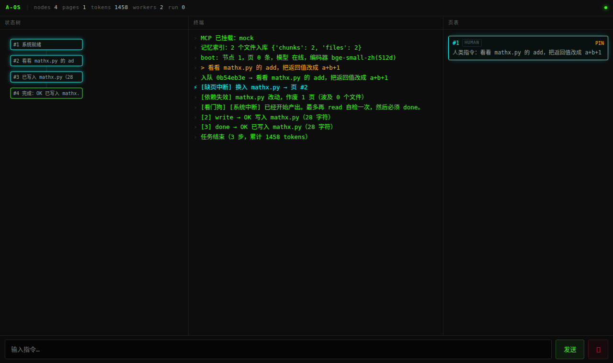
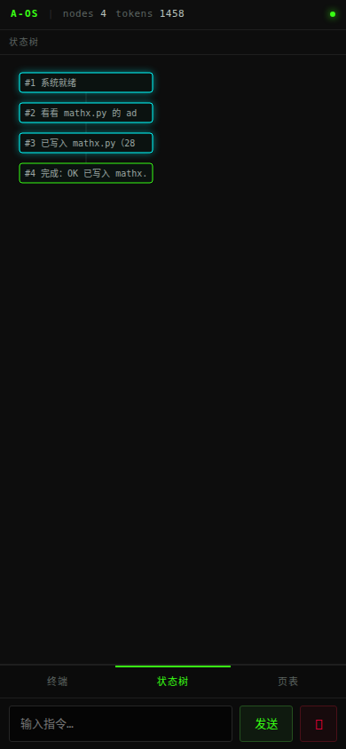

# A-OS

把操作系统的内存管理与进程调度搬进 LLM Agent 的运行时：上下文不是一段不断变长的 `messages` 数组，而是一块可以被换页、可以被淘汰、可以按段隔离的虚拟内存。

```
用户输入 → 事件合并 → 调度器 → 内核循环 → 动作执行 → 状态树 / 页表
                        ↑                          ↓
                    看门狗 / 检查点 / 锁        控制台（WebSocket）
```

## 它解决什么

普通 Agent 跑长任务时，上下文只会一路堆叠，跑到几十轮就 token 爆炸、开始"忘记自己在干什么"。

A-OS 的做法是给它一套操作系统的约束：

- **分页**：文件内容按需换入，不预先全塞
- **分段**：系统、人类指令、任务状态、数据四段隔离，低优先级的才允许淘汰
- **缺页中断**：模型缺信息时发信号，内核去磁盘或向量索引里把页换进来
- **状态树**：记录的是"做过什么"的抽象状态，不是原始 JSON 日志
- **看门狗**：检测空转和重复动作，超预算就掐断

## 控制台

桌面三栏（状态树 / 终端 / 页表），手机切 Tab，输入框固定在底部。



<p align="left">
  
</p>

## 核心模块

| 模块 | 作用 |
|---|---|
| `kernel/page_table.py` | 页表：四段内存、LRU、语义检索、失效 |
| `kernel/state_dag.py` | 状态树：CoW 分支、成功后验剪枝 |
| `kernel/kernel_scheduler.py` | 调度：优先级队列、协程取消、文件锁 |
| `kernel/io_spooler.py` | 输入防抖：2 秒内的操作合并成一个中断事件 |
| `kernel/executor.py` | 动作执行：读写、列目录、搜索、shell、MCP |
| `kernel/shell_sandbox.py` | 命令白名单、路径锁定、超时、输出截断 |
| `kernel/journal.py` | 任务日志与崩溃恢复，租约防抢 |
| `kernel/progress.py` | 进度看门狗：重复动作检测、读配额 |
| `kernel/depgraph.py` | 依赖图：改文件后相关记忆自动失效 |
| `kernel/memindex.py` | 向量索引：文件切块 + bge 编码，缺页按语义寻址 |
| `kernel/lock.py` | 跨进程锁：Redis SET NX 优先，fcntl 兜底 |
| `kernel/sanitize.py` | 上下文净化：剥掉原始 JSON，只留人话状态 |
| `drivers/model.py` | 模型驱动：OpenAI 兼容接口，带重试和 token 记账 |
| `drivers/embedding.py` | 本地向量：bge-small-zh（ONNX，CPU） |
| `drivers/protocol.py` | 动作协议与缺页信号解析 |
| `cluster/` | 多进程 Worker 集群：Redis 队列 + 结果 Pub/Sub |
| `web/` | 控制台：状态树拓扑图、终端流、页表，适配手机 |

## 快速开始

```bash
# 依赖
pip install onnxruntime tokenizers redis aiohttp

# 本地向量模型（约 91MB，从 ModelScope 下）
mkdir -p models/bge-small-zh && cd models/bge-small-zh
curl -L -o model.onnx "https://modelscope.cn/models/Xenova/bge-small-zh-v1.5/resolve/master/onnx/model.onnx"
curl -L -o tokenizer.json "https://modelscope.cn/models/Xenova/bge-small-zh-v1.5/resolve/master/tokenizer.json"

# 模型 key（也可以用环境变量 DEEPSEEK_API_KEY）
echo "DEEPSEEK_API_KEY=sk-..." > ~/.dsh/.env

# 终端模式
AOS_HOME=/opt/aos/data python3 main.py

# Web 控制台
AOS_HOME=/opt/aos/data python3 main.py --web --port 8799
```

没有模型 key 会自动降级到离线内核；没有向量模型会退化成字符哈希，流程仍能跑通。

## 一次任务长什么样

```
[缺页中断] 换入 mathx.py → 页 #2
[1] write → OK 写入 mathx.py（31 字符）
[依赖失效] mathx.py 改动，作废 1 页
[2] done  → 已将 add 改为返回 a+b+1
任务结束（2 步，累计 1777 tokens）
```

## 集群模式

```bash
# 起两个 worker
systemctl start aos-worker@w1 aos-worker@w2

# 提交任务
python3 -m cluster.submit "在工作目录创建 done.txt"
```

两个任务并行跑，互不抢锁；同一文件被两个 worker 同时写时，Redis 锁会串行化。

## 环境变量

| 变量 | 默认 | 说明 |
|---|---|---|
| `AOS_HOME` | `/opt/aos/data` | 状态目录（db、工作区、锁） |
| `AOS_MAX_ROUNDS` | 6 | 单任务最大轮次 |
| `AOS_CTX_BUDGET` | 8000 | 上下文 token 预算 |
| `AOS_OUT_TOKENS` | 3000 | 单次输出上限 |
| `DEEPSEEK_API_KEY` | — | 模型 key |

## 已知边界

- 沙盒是命令白名单，不是真隔离；真要隔离得上容器
- Worker 之间没有共享状态，跨机靠 Redis，但页表不共享
- 向量检索是暴力余弦，万级以内够用，再大需要索引结构
- 崩溃恢复只覆盖任务级，不覆盖正在跑的模型调用

## 许可

MIT
